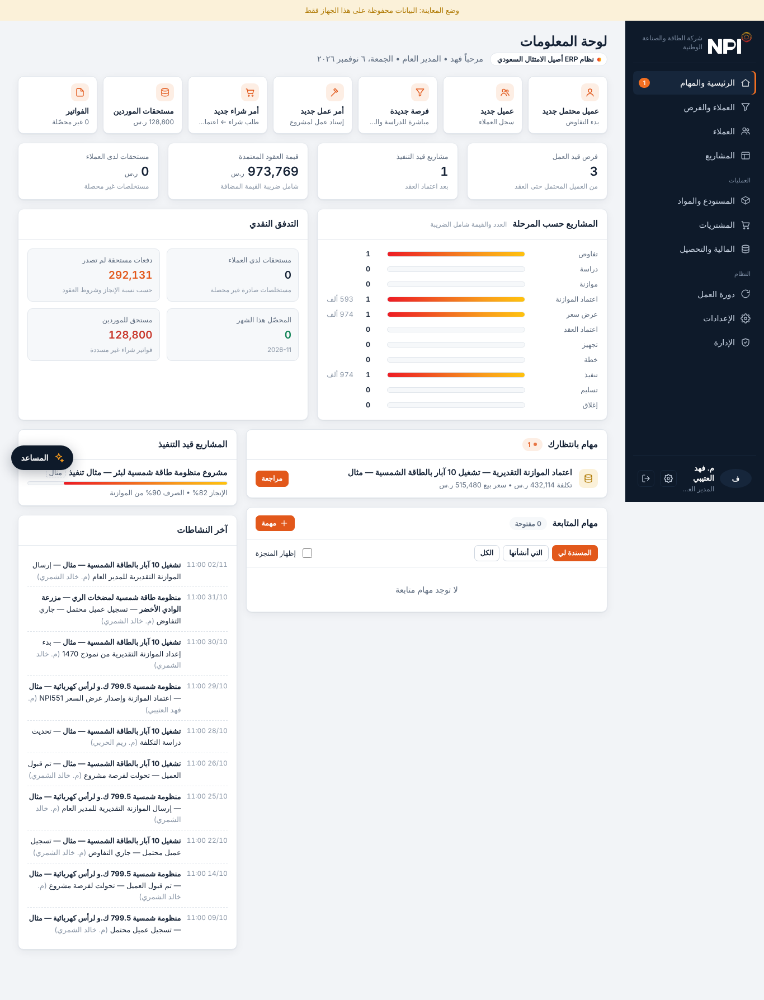

# NPI-KSA — نظام إدارة مشاريع الطاقة الشمسية

نظام ويب لإدارة دورة مشاريع الطاقة الشمسية لشركة **الطاقة والصناعة الوطنية (NPI)** في المملكة العربية السعودية، من العميل المحتمل حتى إغلاق المشروع. الواجهة عربية (RTL) وتعمل على الجوال واللابتوب.



## المزايا

- **دورة عمل من 16 خطوة:** عميل محتمل ← دراسة ← موازنة ← اعتماد المدير العام ← عرض سعر ← موافقة العميل ← عقد ← تجهيز ← خطة ← تنفيذ ← تسليم ← إغلاق.
- **الموازنة والمقايسة:** نماذج موازنة معيارية، وهامش ربح محسوب على سعر البيع، وحدود كميات لكل بند مع طلب اعتماد للتجاوز.
- **التنفيذ اليومي:** إنجاز يومي حسب بنود المقايسة، وعمالة الموقع، وطلبات المواد، وتأكيد الاستلام في الموقع.
- **المستودع والمشتريات:** صرف ونقل المواد، وشراء النواقص (مدير المشاريع ← المالية ← المدير العام)، وأوامر شراء، وإشعارات استلام، ومرتجعات.
- **المالية:** دفعات العقد (توقيع، توريد مواد، نسبة إنجاز، تسليم، محتجزات)، ومستخلصات وتحصيل، وفواتير موردين، ودفعات موردين معتمدة.
- **مستندات PDF بنماذج الشركة:** الموازنة، وعرض السعر، والعقد، وأمر الشراء، وإشعار الاستلام، والنقل، والمرتجع، وطلب المواد، والتقارير اليومية والتراكمية، والتسليم، والمستخلص.
- **الاستيراد والتصدير:** Excel وCSV للعملاء والأصناف والأرصدة والموازنات، مع فلاتر في كل شاشة.
- **الإدارة:**
  - المستخدمون.
  - الأدوار والصلاحيات، مع إمكانية إنشاء أدوار مخصصة.
  - مصفوفة الاعتماد مع حدود مبالغ.
  - بيانات المنشأة وبادئات الترقيم.
  - سجل تدقيق يحفظ القيم قبل التعديل وبعده.
- **لوحة المعلومات:** اختصارات سريعة، وتوزيع المشاريع على المراحل، والتدفق النقدي، ومهام المتابعة وأوامر العمل.
- **المساعد الذكي:**
  - تكتب أو تملي ما تريد إدخاله فيجهّزه المساعد في بطاقة.
  - لا يُحفظ شيء قبل أن يؤكد المستخدم.
  - يعمل بصلاحيات الحساب المفتوح فقط.

## الأدوار

| الدور | أبرز المهام |
|---|---|
| المدير العام | اعتماد الموازنة والعقد وأوامر الشراء ودفعات الموردين وإغلاق المشروع |
| مدير عام المشاريع | الفرص، ورفع الموازنة، وتعيين المهندس، واعتماد الخطة وطلبات المواد والتسليم |
| الإدارة المالية | العقد، وتجهيز المشروع، ومطابقة الموردين، والمستخلصات، والتحصيل |
| المكتب الفني | الدراسة والكميات والموازنة |
| مهندس المشاريع | الخطة، والإنجاز اليومي، والعمالة، وطلبات المواد، والتسليم. يرى الكميات فقط بدون مبالغ |
| أمين المستودع / المحاسب | الصرف والنقل، وطلبات الشراء، والاستلام، والمرتجعات. يرى الكميات فقط بدون مبالغ |
| مدير النظام | المستخدمون، والصلاحيات، ومصفوفة الاعتماد، والمنشأة، وسجل التدقيق |

## هيكل المشروع

```
src/npi-projects.html   مصدر التطبيق (ملف واحد: HTML + CSS + JavaScript بدون مكتبات خارجية)
index.html              نسخة جاهزة للفتح مباشرة في المتصفح (تُبنى من src)
seed/seed.mjs           مولّد البيانات المرجعية والتجريبية
seed/seed.json          البيانات الناتجة
tests/                  اختبارات Playwright الشاملة (t1–t10) وسكربت التشغيل
tools/build.py          يبني index.html من src
docs/screenshots/       لقطات من الواجهة
```

## التشغيل

**النسخة المنشورة:** يعمل التطبيق كـ Artifact على claude.ai. البيانات هناك تُحفظ في قاعدة بيانات مشتركة، والمساعد الذكي يستخدم Claude من حساب المستخدم.

**محلياً:** افتح `index.html` في المتصفح. يعمل التطبيق في «وضع المعاينة» وتُحفظ البيانات على الجهاز فقط (localStorage). المساعد الذكي ورفع الملفات لا يعملان في هذا الوضع.

لتحميل البيانات التجريبية محلياً، افتح أدوات المطوّر في المتصفح ونفّذ:

```js
fetch('seed/seed.json').then(r=>r.json()).then(s=>{localStorage.setItem('npi-local-v1',JSON.stringify(s));location.reload()})
```

إذا منع المتصفح `fetch` من ملف محلي، شغّل خادماً بسيطاً: `python3 -m http.server`.

**الحسابات التجريبية:** كلمة المرور لكل الحسابات `Npi@2026`. أسماء الدخول: `gm` و`pgm` و`finance` و`tech` و`eng1` و`eng2` و`store` و`admin`. **غيّر كلمات المرور واحذف البيانات التجريبية قبل الاستخدام الفعلي** من: الإعدادات ← البيانات.

## الاختبارات

```bash
npm install
npx playwright install chromium
npm test
```

تغطي الاختبارات ما يلي:
- الدورة الكاملة على مشروع جديد بكل الحسابات (74 نقطة).
- المسارات البديلة (45 نقطة): الرفض، وإعادة الفتح، والنقص في المستودع، وإعادة التسليم، والأدوار المخصصة، ومصفوفة الاعتماد.
- الضغط على كل زر في كل شاشة لكل حساب، على مقاس اللابتوب (1366px) والجوال (390px).
- أدوات المساعد الذكي باستخدام محاكي لـ Claude.

## ملاحظات مهمة

- **الصلاحيات تُطبّق في واجهة المتصفح.** هذا مناسب للاستخدام الداخلي، لكنه ليس حماية على مستوى الخادم.
- **لا يوجد ربط مع منصة فاتورة (ZATCA).** عبارة «أصيل الامتثال السعودي» في لوحة المعلومات تحتاج تكاملاً فعلياً قبل اعتمادها في أي مادة تسويقية.
- **ملفات PDF تُنشأ كصور،** لذلك لا يمكن تحديد النص داخلها أو نسخه.
- **الإملاء الصوتي:** إذا مُنع الميكروفون داخل الإطار، استخدم زر الإملاء في لوحة مفاتيح الجهاز.

---

# NPI-KSA — Solar EPC Project Management

Arabic (RTL), mobile-friendly web app for National Power & Industrial Ltd. It covers the full project lifecycle:
- leads, budgets and BOQ;
- quotes and contracts;
- execution logs, materials, procurement and stock;
- supplier payments, client billing and collections;
- handover and close-out.

It also includes role-based permissions, a configurable approval matrix, an audit trail, company-format PDF documents, Excel/CSV import and export, and an AI data-entry assistant that confirms every write and runs under the signed-in user's permissions.

The app is a single HTML file with no dependencies (`src/npi-projects.html`). Open `index.html` locally to run it, or see `tests/` for the Playwright end-to-end suite. Demo accounts use the password `Npi@2026`; change them before going live.
